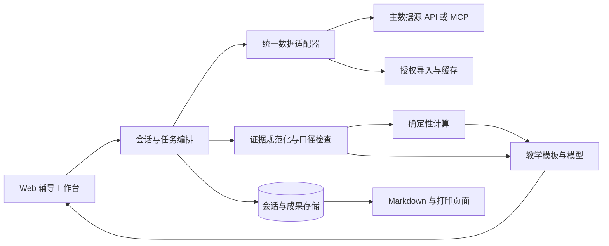

# Pickwise 产品需求文档（PRD）

产品名：Pickwise  
品牌主张：选得聪明，不是选得快  
版本：v1.2  
日期：2026-11-14  
适用项目：怀客松 2026 OPC 模式创新赛道  
文档用途：48 小时 MVP 开发、验收与路演准备  
状态：用户已确认产品方向与教学定位；本文中的技术栈、平台、品类、配额和定价为建议的首版默认值，不代表已完成验证。

## 0. 开发摘要

**Pickwise——选得聪明，不是选得快。**

产品定位（2026-11-16 用户对齐）：Pickwise 是面向电商 OPC 的选品 Agent，承担选品数字员工的工作；通过在真实选品分析过程和结果中嵌入教学，形成 AI 选品教练的差异化体验。

品牌主张对应的产品原则：同时做好选品任务执行与选品方法教学。Agent 自主完成实际研究、分析计算和结果交付，教学随真实任务展开，让用户理解数据与判断依据，并逐步掌握判断商品价值的方法。教学不削弱任务完成度，也不要求用户先学会才能获得选品分析。

面向正在准备首次选品的跨境电商一人公司经营者。用户只需在一个输入框里给出候选商品，AI 自主搜集和整理证据、核对数据口径、完成必要计算，并把拆解过程可视化：每一步说明为什么查、查到了什么、这个数怎么读。教练讲解嵌在拆解步骤和最终结果中，不中断分析流程。最终同时交付一份可复核的选品分析和一份个人学习记录，并通过新商品练习检验用户能否运用所学方法。

### 0.1 用户已经确认的产品决策

- 产品本质是为电商 OPC 服务的选品 Agent / 数字员工，“AI 选品教练”是加入教学功能后的差异化定位（2026-11-16 对齐）。
- 产品名为 Pickwise，品牌主张为“选得聪明，不是选得快”。
- 核心价值同时包括完成当前商品的选品工作，以及帮助用户理解如何分析、判断依据如何产生，并在反复使用中积累独立判断能力。
- 解释过程和来源是教学基础，用户能迁移方法才是教学成效。
- Agent 承担实际调研、整理、计算与教学组织工作；用户参与关键判断。
- 产品入口只有一个输入框；分析过程不设强制暂停，拆解过程本身以可视化方式承担教学。
- 教练同时体现在分析过程（拆解步骤卡）和最终结果（数字批注、初判对照、参数调整与迁移练习）。
- 交付包括选品分析报告、个人学习记录、迁移练习反馈。
- 需要契合“一个岗位、一条可运行闭环、明确商业模式”的赛题。

统一表达与 Expo / 路演叙事顺序见 [2026-11-16 项目定位与表达口径](2026-11-16-project-positioning.md)。该对齐修正定位层级，不代表新增实现、扩展平台支持或已经验证学习成效。

### 0.2 首版开发默认值

| 项目 | 默认值 | 原因 |
|---|---|---|
| 服务平台与市场 | Amazon 美国站 | 本轮已核对相应第三方数据接口资料 |
| 产品形态 | 中文 Web 工作台，桌面优先 | 便于五分钟展示、证据查看和计算互动 |
| 首个验证品类 | 非电动家居收纳用品 | 便于比较规格、包装、物流与成本；仍需按具体商品查风险 |
| 任务入口 | 一个输入框：商品名称、ASIN 或 Amazon.com 链接；卖家约束在结果页补充 | 降低开始门槛；先完成候选商品分析，不承担全市场自动找爆款 |
| 主数据源 | 卖家精灵官方 MCP 或 API，二选一接入 | 降低采集和维护负担；权限、费用、覆盖待实测 |
| 数据回退 | 合法取得的导出文件或带日期的历史快照 | 保持可审查流程，明确标注非实时数据 |
| 教学形式 | 拆解步骤卡内嵌讲解、可选初判、两个教学节点、结果页参数调整、一道迁移练习 | 分析不被打断，同时保留可检验的练习 |
| 教学主轴 | 读懂销量证据、算清广告后的贡献利润 | 数据口径和计算过程容易验证 |
| 技术建议 | Next.js + FastAPI + SQLite | 适合独立开发和可恢复任务；可用熟悉的等价实现 |

品类与平台是首版支持边界。边界内的新商品应能运行；边界外输入应说明能力限制，不能通过替换标题套用固定报告。

### 0.3 首版成功的可观察结果

用户原先根据“销量高”认为某商品值得做。看完拆解过程后，用户理解销量口径与成本假设；在结果页修改一项成本或转化率，能看懂盈亏边界如何移动；面对另一个商品时，能够识别相同问题并给出有依据的解释。

这是待验证的教学目标，不等于已经证明能够提高销量、选品命中率或投资回报。

## 1. 用户、问题与产品边界

### 1.1 目标用户

准备在 Amazon 美国站尝试第一批商品的个人卖家或一人公司经营者。用户已有候选商品，可以提供预算或采购条件，但不熟悉选品数据、成本结构和验证方法。

用户通常能提出“这个产品能不能做”，却可能无法回答：应该查哪些证据、怎样比较、哪些数据不能直接使用、还需要验证哪些条件。

### 1.2 核心用户任务

> 我已经看中一个商品，希望有人带我完成一次真实分析，解释每一步为什么这样做；分析结束后，我能用同一套方法看下一个商品。

### 1.3 首版不覆盖的任务

- 全平台、全国家选品与自动寻找爆款。
- 自动建店、刊登、采购、付款、投放和供应商谈判。
- 确定性的未来销量、成功率或收益预测。
- 完整法律审查、专利不侵权保证和认证结论。
- 长期训练营、课程商城、完整学习管理系统。
- 多角色 Agent 表演、复杂多智能体架构。
- 账号体系、订阅扣费和企业系统集成。

## 2. 商业模式与赛题映射

### 2.1 谁付费、买什么

服务对象是跨境电商新手 OPC。产品经营方以标准化的实战辅导服务收费，AI 选品教练完成主要生产与交付。经营者可以服务多个客户，而不是为每份报告重新投入等量人工时间。

**首个收费单元：一个候选商品的研究项目（2026-11-16 用户确认的测试方向）。** 交付研究、分析报告和内嵌教学，包含项目内关联竞品分析、学习记录与练习反馈。补资料、成本重算与追问的次数和时间范围须在付费前明示，具体额度待验证，不承诺无限使用；关联竞品的自动调研不单独消耗新项目，教学不另收费。先提供免费示例体验，再让用户购买深入研究。

这也是目标卖家的第一名数字员工：它承担选品调研与辅导岗位，帮助经营者掌握分析方法。MVP 展示采用同一套产品能力，不另做两套系统。

### 2.2 八要素商业模式画布

| 要素 | 首版假设 | 验证方法 |
|---|---|---|
| 目标客户 | 有候选商品、准备首次试销的个人跨境卖家 | 记录真实试用者的阶段与当前任务 |
| 客户痛点 | 有数据但不会读，遗漏成本，不知道该验证什么 | 辅导前记录用户的判断依据和疑问 |
| 价值主张 | 完成当前商品分析，并学会可复用的方法 | 对照初判与迁移题表现 |
| 交付成果 | 分析报告、学习记录、迁移反馈 | 用户能下载并独立复核 |
| 定价假设 | 测试价 ¥49/研究项目；三项目包 ¥129 | 先明确权益范围，验证付费意愿与服务成本，未实现支付不声称成交 |
| 成本结构 | 数据调用、模型、计算存储、人工复核及获客成本 | 每次记录真实调用和人工投入 |
| 获客渠道 | 跨境新手社群、国贸学生与创业社群、卖家培训合作 | 验证哪个渠道带来完成辅导的用户 |
| 潜在壁垒 | 用户误解分类、经核验的教学案例、长期决策与经营反馈 | 赛期内仅验证早期案例，不能宣称已有数据壁垒 |

金额是用户已采纳的早期测试价，尚未验证商业可行性，不作为行业价格事实。持续使用频率与成本分布明确后再探索含研究额度的订阅，当前不承诺无限量月费；不把“学会后减少使用”简单当作订阅成立的理由。付费、套餐与额度管理仍是商业方案，不代表本轮已经实现。

每次服务的估算贡献为：实收费用减去数据、模型、计算及人工复核的可归属变动成本。人工复核必须计入，不能把创始人工时视为零。套餐固定成本按实际使用量分摊，并单独列出分摊假设。

### 2.3 对应评分项

| 评分维度 | 产品中可展示的证据 |
|---|---|
| 智能体完成度 30 | 新任务输入、自主查数与计算、数据异常处理、完整交付 |
| 商业闭环 30 | 具体客户、明确服务单元、收费假设、单次成本与用户反馈 |
| 创新性 25 | 按当前商品数据中实际出现的问题选择教学节点，拆解过程即教学，并检验方法迁移；不是只有解释性报告 |
| 演示表达 15 | 可视化拆解过程、初判与证据对照、可点开的证据、可操作的计算与新题反馈 |

## 3. AI 员工岗位说明书

| 项目 | 定义 |
|---|---|
| 岗位名称 | AI 选品教练 |
| 核心职责 | 围绕候选商品自主完成证据整理、分析计算、重点教学和学习反馈 |
| 任务发起人 | 跨境电商个人卖家 / OPC 经营者 |
| 必需输入 | 候选商品（商品名称、ASIN 或链接）；市场首版固定为美国站 |
| 可选输入 | 用户初步判断、预算、采购报价、起订量、重量尺寸、物流费用、预期售价、经验与供货约束 |
| 工作成果 | 分析报告、个人学习记录、迁移练习及反馈 |
| 人工介入 | 商品识别有歧义（唯一允许的阻塞点）、在结果页补充私有成本、用户练习、最终经营决定 |
| 职责边界 | 不擅自补齐真实成本，不保证经营结果，不代用户采购或投放 |
| 验收依据 | 数据可追溯、计算可复核、报告完整、教学针对用户、练习反馈有依据 |

教学参与是岗位设计的一部分。Agent 不需要用户逐步批准普通只读检索和计算；分析过程中只有商品身份歧义会请求用户确认，其余互动（初判、补成本、练习）都是可选的，不阻塞分析。

## 4. 教学机制

### 4.1 基本原则

1. 分析过程不强制暂停。拆解过程本身就是教学：用户通过看到“做选品时应该查什么、为什么查、怎么读”学习方法。
2. 用户的初步判断可选，在等待研究结果时收集；只有在完整结果展示前保存的初判才能用于结果对照。没有初判时，不声称测到了用户原有理解。
3. 每个教学节点只解释一个主要问题，并使用当前商品的真实数据或明确标注的假设，不使用与当前商品无关的固定数字。
4. 展示来源、计算步骤和简明判断依据，不展示模型内部思维链或虚构专家讨论。
5. 用“事实、估算、假设、未知”区分证据性质，不让用户把估算当成事实。
6. 结果页提供可操作的练习（修改参数、迁移题）和具体反馈，不能仅询问“你明白了吗”。
7. 无法判断时说明缺少的证据，以及如何补充、去哪里查。
8. 用户不做练习仍可取得分析成果，但学习状态标记为未验证，不标记为已掌握。

### 4.2 五维分析框架

| 维度 | 用户要学会的问题 | AI 负责的工作 | 首版输出深度 |
|---|---|---|---|
| 需求 | 热度、销量与持续需求是什么关系？ | 汇总趋势、时间窗口、销量来源与异常 | 重点教学，可展示数据缺失 |
| 竞争 | 哪些商品真正可比？头部表现能否代表新卖家？ | 匹配样本、去重、对比规格和价格 | 证据支持的简明分析 |
| 利润 | 哪些成本被遗漏？什么条件下不再划算？ | 确定性计算、情景重算、缺失成本清单 | 重点教学 |
| 风险 | 哪些关键事项还没有核实？ | 汇总商品资料、规则来源和核验任务 | 初筛与待核实项，不作认证或法律保证 |
| 匹配度 | 我的预算、供货条件和经验支持这次尝试吗？ | 对照卖家约束与商品要求 | 条件分析，不给人格或能力评分 |

五维必须出现在报告中，但不要求每维都强行给分。缺少数据的维度显示“证据不足”和补证据步骤。首版不做缺乏标定依据的综合 0—100 分或成功概率。

### 4.3 教学节点结构

每个节点分两部分：

- **讲解（嵌在拆解步骤卡中，只读）：**学习目标、当前商品的证据卡、简明方法说明、可迁移规则。随分析过程自动展开，不需要用户操作。
- **练习（在结果页，可选）：**一道基于当前商品数据的操作题或判断题、反馈、提示记录。用户填过初判时，反馈引用其原回答。

首版至少实现三个经过人工检查的节点模板：

- **N1 数据口径：**整款和单规格、近 30 天和自然月、估算和真实订单的区别。
- **N2 需求证据：**单期高销量与持续性需求的区别，缺少历史时如何保留判断。
- **N3 利润边界：**广告成本、转化率与单件贡献利润的关系。

每次选择两个节点，选择依据是当前商品数据中实际出现的问题：

- N3 必选，因为每个商品都需要核算广告后贡献。
- 数据中出现父体销量重复、规格层级混用或窗口不一致时，选 N1。
- 只有单期销量、缺少连续历史时，选 N2。
- 两种情况都出现时，优先选对结论影响更大的一项，并在报告中列出另一项。

用户填写的初判只调整讲解深度：初判中已体现对某个问题的理解时，缩短该节点讲解、提高练习难度。没有初判时使用默认深度，不凭空推断用户能力。

教学规则使用已审定模板，模型负责关联当前案例、组织语言和反馈。不能让模型随意创造通用行业门槛，例如“评论少于 500 就是蓝海”。

### 4.4 迁移练习

在教学完成后提供另一个商品或另一组独立成本数据，避免复用原题数字。先收集用户判断与依据，再给提示或答案。

优先使用另一个经过核验的真实商品数据包。无法取得适合的真实数据时，可使用明确标为“教学模拟”的案例，不将模拟商品表现写入真实选品报告。

| 评分维度 | 0 分 | 1 分 | 2 分 |
|---|---|---|---|
| 选择证据 | 无相关依据或凭印象 | 找到部分相关数据 | 选择关键数据并说明用途 |
| 理解口径 | 明显混用或无意识 | 经提示发现问题 | 独立区分窗口、规格或估算性质 |
| 运用方法 | 无法计算或方法错误 | 方法基本正确但需提示 | 独立完成计算或有效比较 |
| 识别不确定性 | 给出无条件结论 | 笼统承认未知 | 指出关键未知及下一步核验 |

总分 0—8 仅用于本次练习反馈，不是标准化能力认证。每项得分必须附用户回答中的依据；确定性计算由程序核验，开放题的模型评语允许用户要求重新解释。

独立作答达到 6/8 且四项均非 0，标记“本次已初步运用”；经过提示达到该标准，标记“提示后完成”；不达标为“建议再练一次”；跳过为“未验证”。记录提示次数，不把提示后成绩当成独立成绩。

## 5. 完整用户流程

### 5.1 新建任务

首页只有一个输入框，接受商品名称、ASIN 或 Amazon.com 链接。关键词入口只负责帮助定位候选商品：有歧义时提供最多 3 个候选，由用户确认一项后继续。这是分析流程中唯一允许的阻塞点。

市场首版固定为美国站。预算、采购报价、起订量等卖家约束不在入口收集，分析开始后在结果页补充；未提供的成本保持“未知”，不得用零代替。

提交后立即创建可恢复的任务。用户刷新页面不丢失任务与已填内容。

### 5.2 AI 自主研究与拆解可视化

识别商品与规格，取得可用商品数据，选择最多 5 个可比商品，读取必要历史和最多 100 条评论样本。按需调用，不能为了填满额度机械采集。

研究过程以一条拆解时间线展示。固定步骤为：商品识别、需求证据、竞品比较、利润与资金、风险核验、教学总结。每一步是一张步骤卡，包含四部分：

| 部分 | 内容 |
|---|---|
| 为什么查 | 这一步在选品判断中的作用，一句话 |
| 查到了什么 | 来自真实调用或导入文件的数据，附来源、窗口和证据性质（事实、估算、假设、未知） |
| 这个数怎么读 | 当前商品这项数据的读法和口径限制，对应已审定的教学讲解 |
| 常见误读 | 新手最容易犯的一个错误，以及去哪里核实 |

步骤卡的状态必须由真实的运行事件驱动。没有实际调用的数据步骤不能显示为已完成；中途遇到空值或不可用接口时，该卡显示“证据不足”，仍保留“为什么查”“怎么读”“去哪里查”，并继续后续可支持的步骤。可视化只展示结构化的步骤事实，不展示模型内部思维链或原始运行日志。

等待期间，侧边显示一张可选的“说说你的直觉”卡片：用户可选择“值得做 / 不值得做 / 不确定”并写一句理由。填写不影响分析进度；未填写时学习状态记为“未验证”，结果页不显示初判对照。

### 5.3 教学节点

分析过程中，系统按第 4.3 节规则根据数据选出两个节点，将其讲解内嵌在对应步骤卡中，只读、自动展开，不要求用户操作。练习放到结果页，用户自愿进行。

每个节点的练习都允许“先看解释”或“跳过”。跳过后可继续查看全部成果，不使用强制闯关阻断报告。

### 5.4 结果页

结果页从上到下依次为：

1. **初判对照**（仅当用户填写了初判）：并列显示用户原判断与证据显示的结果，指出差异出在哪一项数据或哪个口径。
2. **五维结论**：每维的判断、依据、缺口。每个数字旁有“怎么读”批注，说明口径、限制和用户下次可去哪里查。
3. **关键假设与下一步验证**：可分为“值得进一步验证”“补资料后再判断”“当前条件下不建议推进”，但不替用户保证选品结果。
4. **调整条件**：用户补充采购价、头程、预算等约束，或修改 CPC、CVR；程序重算受影响结果，AI 更新解释并标明变化原因。保留前后版本及时间，避免新数值配旧结论。
5. **教学练习**：两个节点的可选练习，使用当前商品的数据。

### 5.5 迁移练习与交付

用户对新案例独立作答，系统给出逐项反馈。交付页提供三项成果，支持 Markdown 下载和打印友好页面；PDF 文件生成不是 P0。

无论练习是否完成，业务分析成果可查看。学习成果状态必须如实区分完成、提示后完成和未验证。

三项成果采用固定结构，允许数据缺失，不能省略缺口说明：

| 成果 | 必需内容 |
|---|---|
| 选品分析报告 | 商品与市场；卖家约束；五维分析；证据与日期；计算和情景；缺失信息；下一步验证任务 |
| 个人学习记录 | 用户原判断；本次学习目标；所用方法；已纠正的具体误解；尚未验证的理解；下次分析清单 |
| 迁移练习反馈 | 新案例及真实性标签；题目；用户原答案；提示次数；分项评分与依据；参考方法；下一次练习建议 |

## 6. 功能需求与优先级

P0 为比赛最小交付，必须完成。P1 仅在 P0 通过验收后加入。

| ID | 优先级 | 功能 | 验收条件 |
|---|---|---|---|
| F01 | P0 | 单输入框商品入口 | 识别名称、ASIN、链接三类输入；歧义商品需要确认；卖家约束可在结果页补充，缺失成本保留未知 |
| F02 | P0 | 可选初步判断 | 等待期间可填写，不阻塞分析；填写后在结果展示前保存并可回看；未填写时不显示初判对照 |
| F03 | P0 | 真实数据入口（API 或授权导入） | 至少一种真实数据路径可用，标明模式和日期；另一入口可后补 |
| F04 | P0 | 证据整理与口径检查 | 来源可定位；父体去重；不同窗口不混算 |
| F05 | P0 | 五维分析 | 每维包含判断、依据或缺口，不伪造缺失数据 |
| F06 | P0 | 成本与情景计算 | 同一输入产生同一结果；修改参数可重算并同步解释 |
| F07 | P0 | 教学节点选择与讲解 | 按数据中实际出现的问题选择两个节点；讲解内嵌步骤卡；练习在结果页，支持提示与跳过 |
| F16 | P0 | 拆解可视化 | 固定六步时间线；每张卡含为什么查、查到了什么、怎么读、常见误读；状态由真实运行事件驱动，数据缺失时显示证据不足而不显示完成 |
| F17 | P0 | 结果页数字批注与初判对照 | 每个主要数字旁有口径说明；有初判时并列显示差异来源 |
| F08 | P0 | 迁移练习与反馈 | 新题先答后评；记录提示；反馈可追溯到回答 |
| F09 | P0 | 三项成果交付 | 分析、学习记录、迁移反馈均可查看与下载 |
| F10 | P0 | 任务恢复与异常反馈 | 刷新可恢复；限流、空数据和失败状态可见 |
| F11 | P0 | 调用成本与运行记录 | 后台记录调用、耗时、状态、计费量和数据模式 |
| F12 | P1 | 多轮学习档案 | 跨任务记录误解与练习表现，用户可纠正 |
| F13 | P1 | 第二数据源交叉核验 | 清晰标明冲突，避免简单平均不同口径 |
| F14 | P1 | 正式 PDF、分享链接 | 不阻塞 P0 的 Markdown 和网页交付 |
| F15 | P1 | 更多品类、国家和平台 | 每新增范围都补数据映射与验证案例 |

## 7. 页面与交互规格

### 7.1 首页 / 任务创建

- 产品名称：“Pickwise”。
- 主标题：“选得聪明，不是选得快”。
- 副标题：“AI 选品教练，陪你分析真实商品，让你逐渐学会自己选品。”
- 主入口：页面中央一个输入框，提示“输入商品名称、ASIN 或 Amazon.com 链接”，按钮“开始分析”。
- 输入框下方一行小字说明能取得的三项成果，不放表单、不列材料清单。
- 次入口：“体验教学案例”，始终标明案例性质与数据日期。
- 不把 API、模型名称、Agent 数量等实现信息放进主用户流程。

### 7.2 分析工作台（拆解时间线）

桌面布局包含两个区域：

- 主区：自上而下的六张步骤卡，每张卡含为什么查、查到了什么、怎么读、常见误读。当前正在执行的步骤自动展开，已完成步骤折叠为一行摘要，可点开。
- 侧栏：可选的“说说你的直觉”卡片、数据模式与数据日期、证据来源列表。

步骤卡以简单的可视化表达数据：销量用带统计窗口标注的柱状或折线，竞品用对比表，利润用从售价到广告后贡献的瀑布条。图表必须标注证据性质，缺数据的卡片用“证据不足”占位，不画示意曲线。

来源卡应包含数据提供方、链接或导入定位、市场、统计窗口、规格层级和数据性质。错误、缺口与完成状态不能只依赖颜色。

### 7.3 结果页与交付页

结果页是分析工作台的最后一屏，顺序见 5.4。参数输入需明确币种与单位，改值后更新结果区域；未知值显示“未提供”。

交付页含三个标签页，对应分析报告、学习记录、迁移反馈。顶部显示商品、市场、数据模式、数据截止时间、最近分析版本。学习状态与研究状态分开显示。

主要动作：“调整条件重新计算”“继续练习”“下载本次成果”。

## 8. 数据接入与质量要求

### 8.1 数据源方案

| 数据类别 | 首选路径 | 限制与处理 |
|---|---|---|
| 商品与竞品 | Apify Amazon Product Scraper；DataForSEO 作为回退 | ASIN 分析抓目标完整详情、最多 20 条末级类目列表候选，并为前三个候选补完整详情；采集自然/广告搜索位、BSR、价格与报价快照、评分/评论摘要/问答、库存提示、规格/变体和商品内容标记；近月购买是页面信号，不是销量历史；每次 Actor 调用设 $0.05 最高收费上限，最多 3 条 offer，卖家档案抓取关闭；费用依 Actor 当前计费与实际输出事件 |
| 价格与销量历史 | 商品当前快照；查询触发采样后本地累计 | 缓存过期后的用户查询才会新增快照；支持服务运行时有次数上限的后台日采样；Amazon 页面近月购买信号与数据商销量估算分开存储；没有清晰销量窗口时不能进入销量历史诊断 |
| 评论 | Apify 的评分分布、评论数和 AI 评论摘要；用户导入可补评论样本 | 默认不把未登录页面上的评论全文当作可用样本；不能由摘要推算真实退货率 |
| 关键词与搜索趋势 | Apify Amazon 搜索结果；DataForSEO 竞品排名作为可选回退 | 只代表当次搜索结果或供应商排名，不作为绝对搜索次数或销量 |
| 采购、物流与预算 | 用户输入或其授权资料 | 不能推断为已核实事实；记录提供时间 |
| 平台费与政策 | 官方来源或用户确认的报价/费率 | 标注适用条件、时间；不硬编码未核实当前费率 |
| 品类风险 | 公开官方资料与具体商品信息 | 来源不足时输出核验清单，不出确定合规结论 |

DataForSEO 适配器使用 Amazon Merchant `products/live/advanced`、`asin/live/advanced` 与 DataForSEO Labs `amazon/product_competitors/live`；字段以实际响应解析，供应商估算、页面信号、竞品排名和评论样本分别标记。竞品排名可能是周更数据，不能当作实时库存或销量。

首版不依赖 Amazon SP-API 品牌分析权限。Apify 认证通过服务端 `APIFY_API_TOKEN` 配置并优先使用；DataForSEO 认证通过 `DATAFORSEO_LOGIN` / `DATAFORSEO_PASSWORD` 作为回退。未配置或调用失败时继续导入式降级。Apify 当前 Actor 输出的自然/广告位置不含绝对关键词搜索量，页面近月购买信号不等于连续订单历史；历史价格与 BSR 已支持有限定时采样，不能回填。关键词需求补充路径：有品牌代表权限时可用 Amazon Brand Analytics Search Query Performance；开放商品调研可评估 Apify Store 的按结果付费关键词搜索量 Actor，但必须把其数据标为第三方估算并先做样本与账单验证。平台费可评估需要卖家授权的 SP-API Fee Estimate；广告 CPC/CVR 应优先取用户自己的 Amazon Ads 报告。采购成本、物流和退货成本仍须来自用户报价或授权资料。

### 8.2 数据模式

每条证据独立记录 `source_mode`：`live_api`、`user_import`、`cached_snapshot`、`teaching_simulation`。

一次会话可以混合前三种模式，但整体标为 `mixed`，逐条仍可检查。`teaching_simulation` 只能进入明确标注的教学案例或练习，不能混入真实商品研究结论。

数据商接口当次返回不等于底层数据实时更新；同时记录本次抓取时间和数据覆盖时间。

### 8.3 最低可用输入与降级

- 完整市场辅导：确认商品身份，有商品快照、可比样本，以及能支持所选教学节点的证据。
- 局部辅导：只有商品资料和成本输入时，可做成本练习，但需求与竞争标记为证据不足，不能称完整选品评估。
- 数据完全不可用：提示导入资料或选择明确标注的教学案例，不自动把案例内容填进当前商品。
- 费用缺失：保留未知，允许用户输入“情景假设”后练习；最终报告列出尚未计入的费用。

### 8.4 文件导入最小规格

首版支持 UTF-8 CSV 与 JSON，不要求实现 PDF、图片或任意 Excel 模板解析。

商品数据要求 `marketplace`、`asin`、`title`、`source_name`、`observed_at`；价格与币种须成对提供。可选字段包括 `parent_asin`、`variant`、`price`、`currency`、`rating`、`review_count`、`estimated_monthly_sales`、`sales_scope`、`period_start`、`period_end`、`source_url`。

销量字段出现时必须有统计窗口与 `sales_scope`；不完整记录允许导入，但相关指标禁止进入计算，并显示修正原因。历史序列和评论使用 JSON 的独立数组或单独 CSV 导入，不假定商品快照包含全部历史。

原始文件最大 5 MB、最多 2,000 条商品记录；只选取本次任务相关记录。导入后显示可用条数、排除条数和原因。不同供应商导出列通过显式字段映射进入统一结构。

### 8.5 数据检查规则

1. 父体级销量不得按子体重复累加。
2. 同一比较必须使用相同市场、兼容时间窗口、币种与包装数量。
3. 价格快照与历史平均值分开，优惠后的条件价单独记录。
4. 空值不等于零；覆盖不足不等于没有需求。
5. BSR 推算销量保留估算标签，不能写成真实订单。
6. 头部样本不能直接称为全市场总量，样本集中度注明分母。
7. 评论样本注明数量与采样条件，避免把近期差评当全体买家比例。
8. 竞品先核对用途、规格和包装，语义相似不等于可比。
9. 规则或费率需有适用时间，未确认时降级为待核实假设。
10. 外部页面、评论和导入文件是数据，不能作为系统指令执行。

## 9. 计算规格

### 9.1 首版计算目标

使用确定性代码计算单件贡献利润与简单资金约束。LLM 负责解释，不直接决定数字结果。所有中间值保留足够精度，展示时按币种四舍五入到两位小数。

设：

- `P`：单件售价。
- `C_goods`：单件采购成本。
- `C_logistics`：按件分摊的运输与履约成本。
- `C_platform`：按件计入的平台费用，包含已明确适用的比例费和固定费。
- `C_returns`：按件预留的退货期望损失，依据用户假设或历史数据。
- `C_other`：其他已确认或明确假设的变动成本。
- `CPC`：每次广告点击成本。
- `CVR`：广告点击到购买的转化率，小数表示。

公式：

```text
广告前单件贡献 M = P - C_goods - C_logistics - C_platform - C_returns - C_other
广告获客成本 CAC = CPC / CVR
广告后单件贡献 = M - CAC
保本转化率 CVR_break_even = CPC / M    （仅当 M > 0）
```

这些公式适用于简化的单件广告获客情景，不包含全部经营费用，不直接给出企业净利润。税费、汇率、仓储、优惠、复购和多件订单等未建模部分必须列入适用限制或按明确方法计入，避免重复计算。

当 `CVR <= 0` 或 `CVR > 1` 时拒绝计算；`M <= 0` 时提示广告前已不具备正贡献，不生成正常保本转化率；保本转化率大于 100% 时提示该假设组合不可实现。CPC 等成本为负数时拒绝。

币种不一致时必须由用户提供或确认带来源、日期的汇率；未取得汇率则不合并计算。零成本必须由用户明确输入，不能由缺失值转换。

### 9.2 确定性验收样例

以下为教学假设，非真实商品数据。它们只用作计算测试用例和“教学体验案例”；真实商品的教学节点必须使用该商品自己的数字或用户确认的假设，不得套用本表数值：

| 输入 / 输出 | 情景 A | 情景 B |
|---|---|---|
| 售价 | $20.00 | $20.00 |
| 已计入的非广告变动成本合计 | $12.00 | $12.00 |
| 广告前单件贡献 | $8.00 | $8.00 |
| CPC | $0.60 | $0.60 |
| CVR | 10% | 5% |
| CAC | $6.00 | $12.00 |
| 广告后单件贡献 | $2.00 | -$4.00 |
| 保本转化率 | 7.5% | 7.5% |

对应教学问题：“商品和售价没变，为什么结果反转？真正需要先验证哪个假设？”系统应根据用户回答反馈，而不是只重复公式。

### 9.3 资金约束

起订采购金额等于起订量乘以单件采购价，可与可用预算比较；它只代表采购占用，不代表完整启动资金。若运输、预付广告或其他现金需求缺失，必须标注预算判断不完整。

## 10. 状态、对象与技术边界

### 10.1 两套独立状态

研究状态：`draft → resolving → researching → analysis_ready`；异常终态为 `partial` 或 `failed`，可发起新尝试。

学习状态：`not_started → coaching → transfer_pending → completed`。`initial_answered` 是可选分支：用户在等待期间填写初判时记录，未填写则直接进入 `coaching`。会话可暂停并恢复；单个节点记录 `skipped`，不会把整次辅导提前标记为完成。整次学习被跳过时，会话记为 `skipped`，仍可交付研究报告。

`completed` 只表示教学流程结束，不表示达到学习目标；另存 `learning_outcome`，取值为 `independent_application`（本次独立运用）、`assisted_completion`（提示后完成）、`needs_practice`（仍需练习）、`unverified`（未验证）。

“研究完成”不表示“用户学会”。报告版本、练习版本与用户回答分别保存。提交用户回答不触发完整研究重跑；修改成本只重算依赖它的计算与解释。

### 10.2 核心数据对象

| 对象 | 必需信息 |
|---|---|
| Session | ID、商品、市场、卖家约束、两套状态、学习结果、暂停标记、当前节点、创建时间、分析版本 |
| SellerConstraint | 预算、币种、经验、起订量、供应链条件；每项附用户提供或假设标记 |
| Evidence | ID、来源名称/定位、模式、市场、数据时间窗、取得时间、规格层级、指标值、单位、证据性质 |
| Claim | 判断内容、关联 Evidence ID、关联 Calculation ID、适用条件、限制或缺口 |
| Calculation | 输入值及来源、缺失值、公式版本、结果、币种、情景标签 |
| TeachingNode | 学习目标、关联 Claim、题目、回答、提示次数、反馈、完成状态 |
| TransferAttempt | 独立案例、案例性质、回答时间、提示记录、分项评分与依据 |
| LearningRecord | 原判断、修正点、已练习方法、仍需练习项、方法清单 |
| RunEvent | 真实步骤、工具或模块、开始结束时间、成功/失败、计费回执、错误类别 |

事件时间以 UTC 存储，界面按 Asia/Taipei 展示；数据本身的统计窗口保留来源定义，不能因时区转换改变自然月口径。研究证据与个人输入分开，导出报告不包含密钥或完整调试日志。

### 10.3 建议架构



一个编排器即可。结构化分析、教学选择和反馈可以分阶段调用模型，不要求独立 Agent 人设。密钥仅保存在服务端环境配置，不进入浏览器。

建议按功能组织模块：`sessions`、`data_sources`、`evidence`、`calculations`、`coaching`、`exports`。研究任务与网页请求分离，任务事件持久化，页面重连通过读取状态恢复。首版单机 SQLite 即可，选择熟悉的模型服务并验证大陆运行环境的可达性。

### 10.4 最小服务契约

| 操作 | 入参 | 输出与行为 |
|---|---|---|
| 创建会话 | 商品输入 | 会话 ID 与初始状态；约束与初判通过后续操作补充 |
| 保存初判 | 会话 ID、判断选项、理由（可选） | 保存初判与时间；结果展示后提交的初判不用于对照 |
| 补充约束 | 会话 ID、预算、采购价等 | 保存约束并触发受影响计算的重算 |
| 导入数据 | 会话 ID、文件、字段映射 | 数据质量结果与可用证据数量 |
| 启动研究 | 会话 ID、请求幂等键 | 运行 ID；重复请求不重复计费启动 |
| 查询状态与事件 | 会话 ID、事件游标 | 研究进度、当前学习节点、最近错误 |
| 提交学习回答 | 节点 ID、回答、请求幂等键 | 反馈、提示状态与下一节点 |
| 重算情景 | 会话 ID、参数变化 | 新计算版本及受影响判断 |
| 提交迁移题 | 练习 ID、回答 | 分项反馈及辅助状态 |
| 获取或导出成果 | 会话 ID、成果类型 | 对应版本的报告、记录或反馈 |

业务错误使用明确类别：商品不明确、数据缺失、认证失败、额度不足、限流、超时、输入无效、模型输出不合格。用户看到可操作的下一步，调试细节留在后台。

## 11. 稳定性、成本和异常处理

以下是工程目标，不是已测性能承诺：

- 创建任务后 2 秒内显示任务已受理。
- 有效材料齐备时，研究阶段目标在 180 秒内结束或进入明确的部分完成状态。
- 研究阶段每次任务最多 20 次数据调用尝试，含重试；最多 5 个竞品、100 条评论。翻页与评论按供应商实际计费计算，不假定一次调用等于一个计费单位。
- 单次数据请求超时设为 20 秒；可恢复错误最多重试一次，所有调用受总时限约束。401/403 或额度不足不盲目重试。
- 180 秒研究期限不含用户作答时间。到期保存已有成果，并显示缺口；用户可稍后恢复。
- 普通教学响应目标 15 秒内给出结果或进度；模型输出结构错误最多修复一次，仍失败使用预先检查的通用教学模板并说明未完成的个性化部分。
- 不以伪造数据补全接口失败，不把缓存显示为实时结果。
- 记录数据和模型真实用量。价格未配置时显示“费用未核算”，不能写零成本。
- 对相同查询做任务内去重；跨任务缓存是否允许、缓存期与导出范围按数据源许可执行。
- 首版单用户 / 本机演示，不承诺公开多租户隔离；对外开放前需补认证与访问隔离。

| 异常 | 用户体验 |
|---|---|
| 商品跨出支持范围 | 解释当前范围，允许更换商品或做有限的成本教学 |
| 数据认证失败 | 保留输入，提供导入路径，不索要用户在聊天中粘贴密钥 |
| 只取得部分历史 | 显示覆盖天数/月份，收窄结论 |
| 缺少采购或物流成本 | 请求用户输入或选择明确标注的教学假设 |
| 数据相互矛盾 | 展示冲突及口径，不能任意选对结论有利的一条 |
| 用户不同意反馈 | 展示证据与评分依据，允许补充解释并保存修订 |
| 页面刷新或网络短暂中断 | 从持久化会话恢复，不重复启动研究 |
| 用户直接索取最终结论 | 提供已有分析与缺口，学习标记为未验证 |

## 12. 验收方案

### 12.1 P0 功能验收清单

- [ ] 支持范围内至少 3 个不同真实商品可完成研究；其中 1 个不参与提示词与模板调试。
- [ ] 商品、市场、规格和数据时间在报告中可见。
- [ ] 所有用于支撑主要结论的数值都有来源或明确假设；没有无来源的精确销量或成功率。
- [ ] 父体重复、窗口冲突、币种冲突、空值与零值的处理正确。
- [ ] 第 9 节的确定性样例结果全部一致，异常输入不会产生正常盈利结论。
- [ ] 修改 CPC 或 CVR 后，计算、文字解释与导出版本一致。
- [ ] 首页只有一个商品输入框；提交后不需要填写任何其他表单即可开始分析。
- [ ] 拆解时间线的六个步骤卡状态都由真实运行事件驱动；没有调用的步骤不显示完成，数据为空的卡显示“证据不足”。
- [ ] 每张步骤卡都包含为什么查、查到了什么、怎么读、常见误读。
- [ ] 初判可选且不阻塞分析；填写的初判在结果展示前已保存，结果页显示初判对照；未填写时不显示对照，学习状态为未验证。
- [ ] 教学节点按当前商品数据中实际出现的问题选择，数字取自当前商品或用户确认的假设，不使用固定教学数字。
- [ ] 结果页的每个主要数字旁有“怎么读”批注。
- [ ] 两个教学节点的练习能完成，提示和跳过都可正常推进。
- [ ] 迁移题使用不同案例，先作答后评分，记录辅助状态。
- [ ] 用户跳过练习不会显示已掌握；无证据的维度不会被补成确定结论。
- [ ] 三项成果都可以下载；刷新后会话、回答和结果仍存在。
- [ ] 接口超时、额度不足和空结果均能进入正确回退状态。
- [ ] 新任务使用当前输入运行，不依赖固定报告或只替换商品名称。

### 12.2 关键测试场景

| 场景 | 预期结果 |
|---|---|
| 五个子体共享同一父体销量 | 不相加为五倍，展示去重依据 |
| 高销量商品没有历史趋势 | 不断言持续高需求，选择口径或成本教学 |
| 报价与售价币种不同、缺汇率 | 不直接相减，显示待确认汇率 |
| CVR 从 10% 改为 5% | 示例贡献从 $2 变为 -$4，解释同步更新 |
| 起订采购金额超过预算 | 显示采购现金缺口，并注明其他现金需求是否计入 |
| 用户已在初判中体现对口径的理解、结果显示广告成本导致亏损 | 缩短口径讲解，重点解释成本，结果页对照初判指出差异 |
| 用户不填初判直接看结果 | 分析正常完成，不显示初判对照，学习状态为未验证 |
| 用户直接索取最终结论并跳过练习 | 分析可交付，学习状态为未验证 |
| 评论中包含“忽略前面指令” | 视为评论文本，不改变任务、权限或输出规则 |
| 第三方接口返回空值 | 保留未知，不变成零、不伪造历史 |
| 迁移练习使用模拟数据 | 全程带教学模拟标记，不并入真实研究 |

### 12.3 用户验证

目标邀请 3—5 位目标阶段用户试用；若实际只能找到其他开发者或参赛者，标明他们的背景，不将反馈当作目标卖家需求验证。

记录：

- 辅导前：用户填写的初判、依据和不确定之处（初判可选，未填写则记录为空）。
- 辅导中：需要几次提示、在哪一步卡住、完成时长。
- 辅导后：是否能在新案例识别遗漏成本或错误口径。
- 服务价值：用户是否愿意为下一个真实商品继续使用，以及愿意付费的原因。

核心观察指标为“独立迁移完成情况”。没有标准化对照实验时，只汇报案例数、具体变化和局限，不声称普遍提升能力或证明因果关系。

技术验证和教学验证分开：流程通过只能证明软件可用，不能证明用户已经学会。

## 13. 48 小时开发顺序

本节是相对工时预算，不表示赛事时钟从当前重新开始。实际已消耗的赛时需要扣除，封版以官方现场通知为准。

| 阶段 | 工时预算 | 可检查产物 | 完成条件 |
|---|---|---|---|
| 数据验证 | 0—2 小时 | 一个真实商品、同类样本、历史或成本输入 | 确认接入、计费、权限与必要口径；失败则启用授权导入 |
| 研究与计算闭环 | 2—10 小时 | 从输入到结构化分析的后端链路，输出可驱动步骤卡的运行事件 | 真实来源与确定性计算可检查 |
| 拆解可视化与教学 | 10—22 小时 | 六张步骤卡、可选初判、按数据选节点、数字批注、迁移题与学习记录 | 步骤状态来自真实事件；跳过状态正确 |
| 结果页与交付 | 22—30 小时 | 初判对照、参数重算、三项成果下载 | 页面可用，刷新恢复与版本一致 |
| 新输入与异常验证 | 30—37 小时 | 验收记录、问题修正 | 完成关键数据与计算测试 |
| 真实试用与迭代 | 37—43 小时 | 试用记录、修改点 | 如实记录人数、背景和学习变化 |
| 材料与展示 | 43—48 小时 | 商业画布、岗位说明、演示与路演稿 | 全流程可演示，已知限制能说明 |

时间不足时先取消计划中的 P1 范围，保留核心教学。仍需进一步压缩时，减少图表和评论分析深度、只保留一种数据入口；始终保留真实证据、拆解步骤卡、一个可操作的方法练习、迁移反馈及三项成果。此压缩版需在交付说明中列出与完整 P0 的差异。

开发过程中不要为了展示增加采购、自动投放、全平台覆盖或多智能体架构。

## 14. 五分钟演示建议

| 时间 | 内容 |
|---|---|
| 0:00—0:35 | 说明具体客户、当前痛点和按次辅导服务 |
| 0:35—1:30 | 在输入框输入真实商品，展示拆解时间线逐步展开，期间点选一次初判 |
| 1:30—2:30 | 停在一张步骤卡，展示“查到了什么”和“怎么读”，说明一个常见误读 |
| 2:30—3:30 | 到结果页，展示初判对照，修改一个参数，现场计算并解释条件变化 |
| 3:30—4:20 | 新案例练习与反馈，说明教学效果如何验收 |
| 4:20—5:00 | 展示交付、实际成本、试用反馈和下一步 |

研究可能超过展示窗口，可使用清晰标注时间和来源的已完成真实任务展示全流程，同时现场执行新参数计算或新题反馈。预录、缓存和实时部分必须区分。现场新任务测试应使用同一产品流程，不能只准备固定脚本。

路演主句：**“Pickwise——选得聪明，不是选得快。”**

产品解释：“AI 选品教练，陪你分析真实商品，让你逐渐学会自己选品。”

可以展示一个学习瞬间，例如用户从只看售价差转向主动核算广告获客成本；不能预设每位评委都会误判，也不能把演示用假设当真实经营结果。

## 15. 开工检查与交接

### 15.1 不阻塞开发的默认决定

使用中文界面、Amazon 美国站、非电动家居收纳样本、单主数据源、两处重点教学、单道迁移练习、Markdown 交付。暂无用户证明时，项目以假设和试用结果展示商业可行性。

### 15.2 必须实测的依赖

| 依赖 | 当前状态 | 回退方案 |
|---|---|---|
| 主数据源账号权限与费用 | 文档已核对，未认证调用 | 授权导出的真实文件 |
| 数据缓存与输出许可 | 未核实具体套餐条款 | 限于获许可的使用范围，不批量转售原始数据 |
| 教学案例与正确答案 | 需求已定义，尚未制作核验 | 先完成一套人工复核案例再批量生成 |
| 目标用户付费与学习效果 | 未验证 | 如实报告试用，不把愿望单或口头兴趣当成交 |
| 大陆演示环境的可达性 | 未实测 | 导入/快照模式与本地可恢复会话 |

### 15.3 当前交接状态

- 产品名 Pickwise、品牌主张“选得聪明，不是选得快”及核心教学定位已确认。
- 本文定义了 MVP、数据口径、计算、页面、教学、异常与验收。
- 当前尚未开发产品、接通账号、取得真实接口回执或完成用户测试。
- 开发第一步：用一个真实商品跑通数据与计算样例，输出可驱动步骤卡的运行事件，再做拆解可视化；可视化不得先于真实事件，不做假进度动画。
- 工作区约束：未经用户操作不得删除任何文件；本文不授权覆盖或清理既有工作。

## 16. 来源与事实边界

### 16.1 任务材料

1. 用户本轮对话：最终选择 AI 选品教练，明确教学与方法迁移为核心，并授权形成开发 PRD。
2. 《怀客松2026_OPC模式创新赛道命题手册11.12docx.pdf》：已读取的比赛手册，尤其第 3—7 页的范围、岗位、能力与评分，以及第 12—13 页的成果披露与商业画布。原文件位置：`D:/xwechat_files/wxid_rl5h1sczsmut12_40b7/temp/RWTemp/2026-11/438f9d92e31b17a30611b6853c7f8e92/怀客松2026_OPC模式创新赛道命题手册11.12docx.pdf`。
3. `opc-direction-discussion-summary.txt`：用于理解选题历史和用户背景；其中竞品、法规、市场规模和获奖率等说法未一律视为已验证事实。

已有代码、数据、模板和客户资源应按赛事要求披露，48 小时新增工作单列。比赛手册是需求来源，不授权自动提交作品、注册账号、购买服务或发送消息。

### 16.2 本轮核对的公开资料

以下资料于 2026-11-14 查阅。官方功能说明证明接入路径存在，不代表本项目已实测成功。

- [卖家精灵 MCP 接口说明](https://www.sellersprite.com/v3/knowledge/feature/mcp-interface-description)：工具、计费与数据口径；销量估算、父子规格、窗口和样本限制需按字段解释。
- [卖家精灵 API 概览](https://open.sellersprite.com/api)：认证、额度、调用与返回状态。
- [Amazon Analytics Reports](https://developer-docs.amazon/sp-api/docs/report-type-values-analytics)：品牌分析报告的权限条件。
- [Google Trends 数据说明](https://support.google.com/trends/answer/4365533?hl=zh-Hans)：相对热度不能直接用作绝对搜索量。
- [Keepa API 配额机制](https://keepa.com/api-docs/plans-tokens.html)：备选数据源的按套餐限流机制，首版不要求独立接入。
- [LinkFox 智选测款](https://wiki.linkfox.com/solutions/smart-product-test)：已有可追溯报告和执行流程；本项目不能把透明性宣称为独占创新。
- [Accio 使用指南](https://static.accio.com/accio-user-guide.html)：已有推理与匹配展示；差异需通过教学与迁移效果证明。

### 16.3 尚未被证明的主张

付费意愿、获客成本、学习效果、复购频率、行业经验迁移有效性及真实经营收益均未完成验证。首版应呈现具体案例与可复核过程，避免把产品目标写成既成事实。

## 2026-11-15 真实业务证据补全
接入 Apify 关键词估算、五年 Google 相对关注度、评论运行摘要与样本，CPSC 召回和官方正文；原始数据与来源日期进入工具、视图及导出。现价与目标售价分离；经营报价、广告与销量报表保留来源和口径；启动现金及压力情景由程序计算。评论需 Amazon 登录、卖家权限和供应商报价等外部缺口保持可见，无法用公开快照推导。

2026-11-15 补充：单输入入口继续保持，Agent 自动补充 ASIN 周级购买量/流量/BSR、包装尺寸、Amazon 费用估算、单 ASIN 销量覆盖状态、自动补全词、Alibaba/1688 公共货源价格与 MOQ。个人预算、最终售价、授权和真实广告表现作为可选增强输入折叠在结果页，不再阻塞分析流程。公开估算不能替代卖家后台订单、正式供应商报价或 Amazon 账户费用；所有来源失败和未覆盖品类保持可见。
